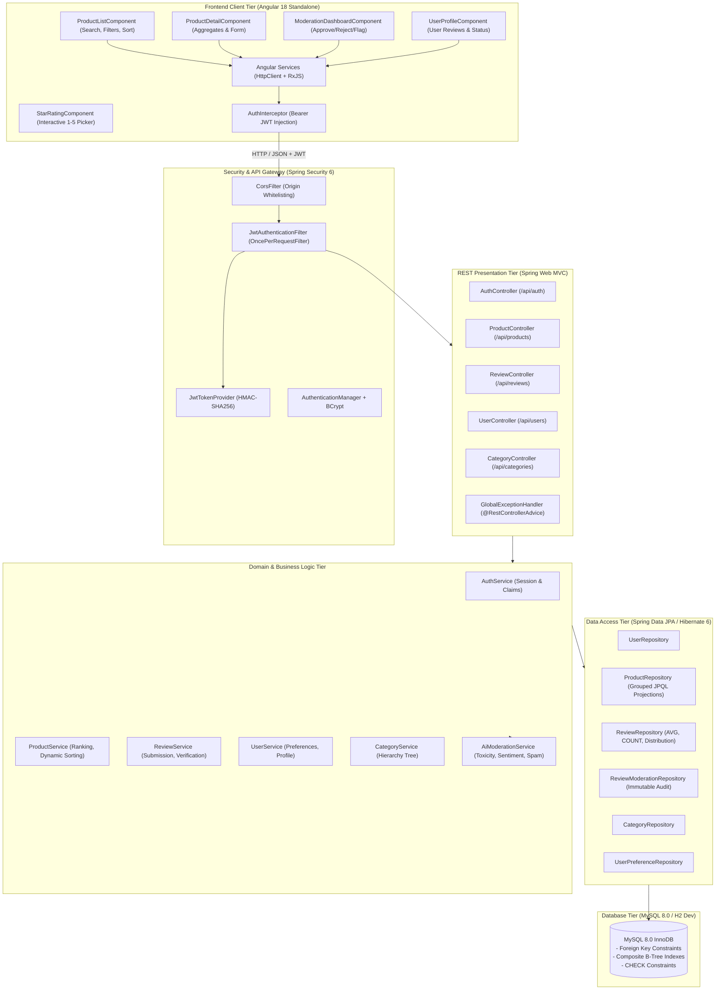
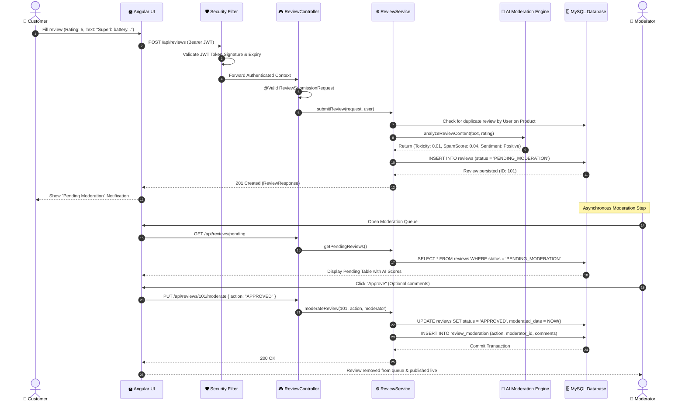
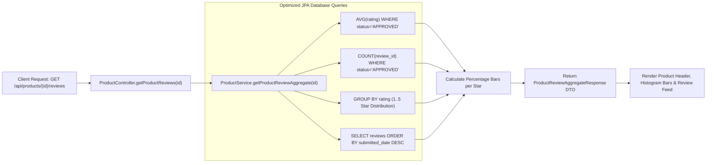
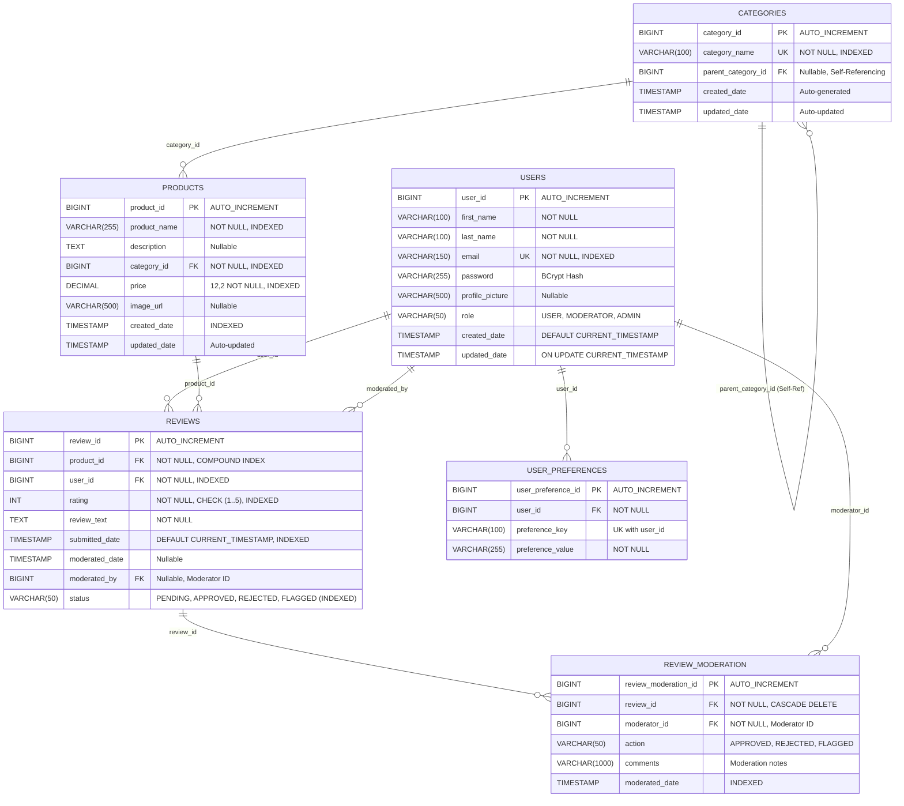
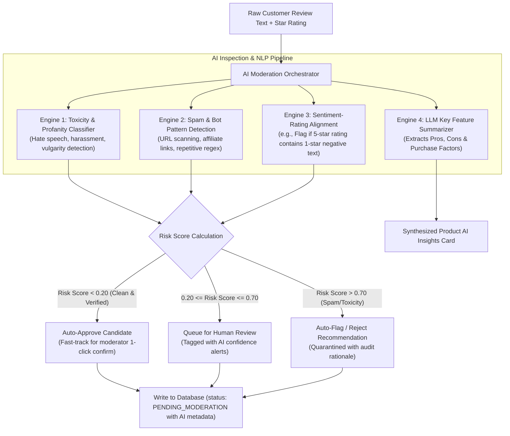
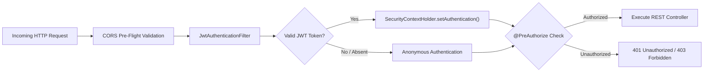

# Web-based Product Rating and Review System (W-PRRS)

[](https://openjdk.org/)
[](https://spring.io/projects/spring-boot)
[](https://spring.io/projects/spring-security)
[](https://hibernate.org/orm/)
[](https://www.mysql.com/)
[](https://angular.dev/)
[](https://tailwindcss.com/)
[](https://jwt.io/)

> **W-PRRS** is an enterprise-grade, high-throughput rating, review aggregation, and content moderation platform. Built using **Spring Boot 3 (Java 17+)**, **Hibernate 6 ORM**, **MySQL 8.0**, and **Angular 18 Standalone Components with Tailwind CSS**, the system incorporates an **AI-driven review moderation pipeline** with automated sentiment scoring, spam detection, and audit logging.

---

## 📑 Table of Contents
- [1. System Architecture](#1-system-architecture)
- [2. Architectural Workflows & Sequence Diagrams](#2-architectural-workflows--sequence-diagrams)
- [3. Entity-Relationship & Database Schema](#3-entity-relationship--database-schema)
- [4. AI-Powered Content Moderation Pipeline](#4-ai-powered-content-moderation-pipeline)
- [5. Technology Stack & Engineering Tooling](#5-technology-stack--engineering-tooling)
- [6. RESTful API Specification](#6-restful-api-specification)
- [7. Security Architecture & RBAC Matrix](#7-security-architecture--rbac-matrix)
- [8. Real-Time Feedback Aggregation Engine](#8-real-time-feedback-aggregation-engine)
- [9. Local Setup & Execution Guide](#9-local-setup--execution-guide)
- [10. Project Directory Layout](#10-project-directory-layout)

---

## 1. System Architecture

The application adopts an **N-Tier Layered Hexagonal/Clean Architecture** with separation of concerns between presentation, domain logic, data persistence, and intelligent content inspection:



---

## 2. Architectural Workflows & Sequence Diagrams

### 2.1 Review Submission & Moderation Lifecycle



### 2.2 Rating & Feedback Aggregation Engine



---

## 3. Entity-Relationship & Database Schema

The database design adheres to 3NF relational normalization with explicit foreign keys, cascading deletion rules, and B-Tree indexes optimized for high-volume aggregation and filtering:



### 🎯 Key Indexing Strategy:
- **`idx_reviews_product_status` (`product_id, status`)**: Enables instant computation of `AVG(rating)` and `COUNT(*)` over millions of rows without a full table scan.
- **`idx_product_price` and `idx_product_category`**: Guarantees sub-millisecond execution for catalog price-bracket filtering and hierarchy navigation.
- **`idx_users_email` (Unique B-Tree)**: O(1) lookup during JWT authentication and login requests.

---

## 4. AI-Powered Content Moderation Pipeline

W-PRRS incorporates an **Intelligent AI Processing Pipeline** designed to assist human moderators and protect platform integrity against review spam, bots, and toxic content:



### AI Pipeline Features:
1. **Automated Sentiment vs. Star Rating Discrepancy Detection**:
   Flags potential sarcasm, bot poisoning, or erroneous ratings (e.g., giving 5 stars while writing *"Broke on day one, terrible customer service"*).
2. **Promotional & Spam URL Filtering**:
   Detects phishing URLs, affiliate tokens, and spam strings (e.g., `http://spam-example.com`) and flags them for immediate rejection.
3. **LLM Product Review Summarization**:
   Aggregates hundreds of customer reviews into an intuitive summary card highlighting top strengths and weaknesses.

---

## 5. Technology Stack & Engineering Tooling

| Domain | Technology / Tool | Version | Purpose & Rationale |
|---|---|---|---|
| **Language** | **Java** | 17+ LTS | Modern language features (Records, Pattern Matching, Text Blocks). |
| **Framework** | **Spring Boot** | 3.3.5 | Production-ready microservice foundation with embedded Tomcat. |
| **Data Persistence** | **Spring Data JPA / Hibernate** | 6.5 | Type-safe ORM, dynamic queries, connection pooling via HikariCP. |
| **Database** | **MySQL Server** | 8.0 | ACID-compliant relational storage with InnoDB and B-Tree indexes. |
| **Dev Database** | **H2 Database** | 2.2 | Zero-setup in-memory database with MySQL syntax emulation. |
| **Security** | **Spring Security + JJWT** | 6.3 / 0.12.5 | Stateless authentication using HMAC-SHA256 tokens and method-level RBAC. |
| **Validation** | **Jakarta Bean Validation** | 3.0 | Declarative input validation (`@NotNull`, `@Size`, `@Min`, `@Max`). |
| **Frontend Framework**| **Angular** | 18+ | High-performance standalone components and typed reactive forms. |
| **Styling** | **Tailwind CSS** | 3.4 | Utility-first, responsive, and mobile-first design system. |
| **Build & Package** | **Apache Maven** | 3.9+ | Declarative dependency management and build automation. |
| **Package Manager**| **Node.js / npm** | 22.x / 10.x | Frontend runtime, bundling, and local development. |
| **Version Control** | **Git & GitHub** | 2.46+ | Distributed version control and team collaboration. |

---

## 6. RESTful API Specification

### Authentication Endpoints
- `POST /api/auth/register` - Registers a new user. Returns JWT token and profile.
- `POST /api/auth/login` - Authenticates user credentials. Returns JWT token.
- `GET /api/auth/me` - Retrieves currently authenticated user profile.

### Review Submission & Moderation Endpoints
- `POST /api/reviews` *(Authenticated)*:
  - Submits a review; initializes state to `PENDING_MODERATION`.
  ```json
  // Request Payload
  {
    "productId": 1,
    "rating": 5,
    "reviewText": "Superb noise-cancellation and battery life. Highly recommended!"
  }
  ```
- `PUT /api/reviews/{id}/moderate` *(Role: MODERATOR, ADMIN)*:
  - Updates review status and records an audit log into `review_moderation`.
  ```json
  // Request Payload
  {
    "action": "APPROVED", // APPROVED | REJECTED | FLAGGED
    "comments": "Verified authentic customer feedback."
  }
  ```
- `GET /api/reviews/pending?page=0&size=15` *(Role: MODERATOR, ADMIN)*:
  - Fetches paginated reviews pending review by the moderation team.

### Product & Aggregate Feedback Endpoints
- `GET /api/products`:
  - Query Parameters: `categoryId`, `minPrice`, `maxPrice`, `search`, `sortBy` (`rating_desc`, `reviews_desc`, `price_asc`, `price_desc`, `newest`), `page`, `size`.
- `GET /api/products/{id}`:
  - Returns product specifications and details.
- `GET /api/products/{id}/reviews`:
  - Returns verified approved reviews, calculated average rating, and star breakdown:
  ```json
  {
    "productId": 1,
    "productName": "SonicPro Wireless Noise-Cancelling Headphones",
    "averageRating": 4.8,
    "reviewCount": 24,
    "ratingDistribution": { "1": 0, "2": 1, "3": 2, "4": 5, "5": 16 },
    "reviews": [ ... ]
  }
  ```

### User Profiles Endpoints
- `GET /api/users/{id}/reviews` *(Authenticated)*:
  - Returns all reviews submitted by the user joined with product cards and status tags.
- `GET /api/users/{id}/preferences` | `PUT /api/users/{id}/preferences`:
  - User notification and display preferences.

---

## 7. Security Architecture & RBAC Matrix

Authentication is handled via **Stateless JWT Tokens** signed with HMAC-SHA256. Outgoing frontend HTTP requests automatically inject the `Authorization: Bearer <token>` header through Angular's `authInterceptor`.



### Role-Based Access Control (RBAC) Matrix

| Endpoint | Anonymous / Public | Customer (`USER`) | Moderator (`MODERATOR`) | Admin (`ADMIN`) |
|---|:---:|:---:|:---:|:---:|
| `GET /api/products/**` | ✅ Allowed | ✅ Allowed | ✅ Allowed | ✅ Allowed |
| `GET /api/categories/**` | ✅ Allowed | ✅ Allowed | ✅ Allowed | ✅ Allowed |
| `POST /api/auth/**` | ✅ Allowed | ✅ Allowed | ✅ Allowed | ✅ Allowed |
| `POST /api/reviews` | ❌ 401 Unauthorized | ✅ Allowed | ✅ Allowed | ✅ Allowed |
| `GET /api/users/{id}/reviews` | ❌ 401 Unauthorized | ✅ Own Profile | ✅ Allowed | ✅ Allowed |
| `PUT /api/reviews/{id}/moderate` | ❌ 401 Unauthorized | ❌ 403 Forbidden | ✅ Allowed | ✅ Allowed |
| `GET /api/reviews/pending` | ❌ 401 Unauthorized | ❌ 403 Forbidden | ✅ Allowed | ✅ Allowed |

---

## 8. Real-Time Feedback Aggregation Engine

To guarantee consistent sub-millisecond response times under high read concurrency, W-PRRS calculates star averages and rating distributions via **single-pass grouped JPQL queries**:

```sql
-- Single-pass aggregate calculation with B-Tree index scan
SELECT 
    AVG(r.rating) AS average_rating,
    COUNT(r.review_id) AS total_reviews
FROM reviews r
WHERE r.product_id = :productId AND r.status = 'APPROVED';
```

```sql
-- Dynamic histogram distribution query
SELECT 
    r.rating AS star,
    COUNT(r.review_id) AS count
FROM reviews r
WHERE r.product_id = :productId AND r.status = 'APPROVED'
GROUP BY r.rating;
```

---

## 9. Local Setup & Execution Guide

### Prerequisites
- **JDK 17+** (OpenJDK / Eclipse Temurin / Oracle)
- **Node.js 18+** and **npm 9+**
- **MySQL 8.0** (Optional for dev profile; H2 in-memory is bundled)

### Test Persona Accounts (Pre-Seeded)
All accounts share the default password: `password123`
- **Customer**: `user@example.com`
- **Moderator**: `moderator@example.com`
- **Admin**: `admin@example.com`

---

### Step 1: Run Backend (Spring Boot 3)

```powershell
cd backend

# Option A: Zero-setup dev mode (in-memory MySQL mode, auto-seeded)
.\mvnw.cmd spring-boot:run

# Option B: Run with native MySQL 8.0 instance
.\mvnw.cmd spring-boot:run -Dspring-boot.run.profiles=mysql
```
- **Backend URL**: `http://localhost:8080`
- **H2 Web Console**: `http://localhost:8080/h2-console` (JDBC URL: `jdbc:h2:mem:wprrs_db`, User: `sa`, Password: *empty*)

---

### Step 2: Run Frontend (Angular 18)

```powershell
cd frontend

# Install dependencies
npm install

# Start development server
npm start
```
- **Web Application**: `http://localhost:4200`

---

### Step 3: Instant Standalone Preview Server (Zero-Dependency)
A standalone Node.js server is included to test both the UI and mocked API endpoints instantly without compiling the full Angular bundle:

```powershell
cd frontend
node server.js
```
Open **`http://localhost:4200`** in any browser.

---

## 10. Project Directory Layout

```
w-prrs/
├── backend/                                   # Spring Boot 3 Backend
│   ├── pom.xml                                # Maven Dependencies & Build Definitions
│   ├── mvnw.cmd                               # Maven Wrapper Executable
│   └── src/
│       ├── main/
│       │   ├── java/com/wprrs/
│       │   │   ├── WprrsApplication.java      # Application Main Entrypoint
│       │   │   ├── config/                    # Security, CORS, JWT & Data Seeding
│       │   │   │   ├── SecurityConfig.java
│       │   │   │   ├── CorsConfig.java
│       │   │   │   ├── JwtTokenProvider.java
│       │   │   │   ├── JwtAuthenticationFilter.java
│       │   │   │   └── DataInitializer.java
│       │   │   ├── entity/                    # JPA Relational Entities
│       │   │   │   ├── User.java
│       │   │   │   ├── Product.java
│       │   │   │   ├── Category.java
│       │   │   │   ├── Review.java
│       │   │   │   ├── ReviewModeration.java
│       │   │   │   ├── UserPreference.java
│       │   │   │   ├── ReviewStatus.java
│       │   │   │   ├── ModerationAction.java
│       │   │   │   └── Role.java
│       │   │   ├── repository/                # Spring Data JPA Repositories
│       │   │   │   ├── UserRepository.java
│       │   │   │   ├── ProductRepository.java
│       │   │   │   ├── CategoryRepository.java
│       │   │   │   ├── ReviewRepository.java
│       │   │   │   ├── ReviewModerationRepository.java
│       │   │   │   └── UserPreferenceRepository.java
│       │   │   ├── service/                   # Business Logic & Aggregation
│       │   │   │   ├── UserService.java
│       │   │   │   ├── ProductService.java
│       │   │   │   ├── ReviewService.java
│       │   │   │   ├── CategoryService.java
│       │   │   │   └── AuthService.java
│       │   │   ├── dto/                       # Data Transfer Objects & Payloads
│       │   │   ├── exception/                 # Global Exception Handling
│       │   │   └── controller/                # REST Controllers
│       │   └── resources/
│       │       ├── application.yml            # Default Dev Configuration (H2)
│       │       ├── application-mysql.yml      # MySQL 8.0 Production Config
│       │       ├── schema.sql                 # MySQL 8.0 Native DDL
│       │       └── data.sql                   # Realistic Mock Seed Data
│       └── test/                              # Unit & Integration Tests
├── frontend/                                  # Angular 18 Client Application
│   ├── package.json                           # Dependencies & Scripts
│   ├── angular.json                           # Angular Workspace Configuration
│   ├── tailwind.config.js                     # Tailwind Theme & Color Setup
│   ├── server.js                              # Standalone Preview Server
│   └── src/
│       ├── index.html
│       ├── main.ts
│       ├── styles.css
│       └── app/
│           ├── app.routes.ts                  # Client Routing Configuration
│           ├── models/                        # TypeScript Interfaces
│           ├── services/                      # Angular Injectable HTTP Services
│           ├── interceptors/                  # JWT Bearer Token Interceptor
│           └── components/
│               ├── navbar/                    # Navigation & Persona Demo Switcher
│               ├── star-rating/               # Interactive 5-Star Picker Component
│               ├── product-list/              # Catalog Grid, Filters & Sort
│               ├── product-detail/            # Aggregate Ratings, Histogram & Form
│               ├── moderation-dashboard/      # Moderator Review Queue & Dialog
│               └── user-profile/              # User Review Cards with Status Badges
└── README.md                                  # Enterprise Engineering Documentation
```

---

## 📄 License
This project is licensed under the MIT License. Developed for enterprise product rating and automated review moderation benchmarks.
